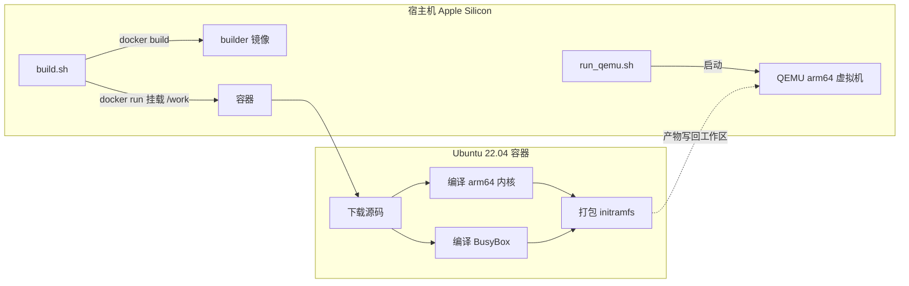

# 从 0 搭建 Linux 系统：完整构建流程与设计取舍

对应脚本：`scripts/build.sh`、`scripts/Dockerfile`、`scripts/build_in_container.sh`、`scripts/run_qemu.sh`。

## 一、为什么是「Docker 编译 + QEMU 运行」



**问题 1：为什么不能直接在 Mac 上编译内核？**

Apple Silicon 系统里的 `gcc` 实为 **Apple clang**，Linux 内核源码大量依赖 GNU GCC 专有特性（`asm goto`、`__attribute__((naked))` 等），Apple clang 编译不过，因此必须有一个真正的 Linux + GNU GCC 环境。

**问题 2：为什么用 Docker 而不是装虚拟机？**

Docker 在 Apple Silicon 上**原生运行 arm64 Linux 容器**，容器里的 GCC 直接跑在宿主机 arm64 CPU 上（非模拟），编译速度等同原生 Linux；Dockerfile 又能把编译车间固化成可复现镜像。

| | Docker 容器 | QEMU 虚拟机 |
|---|---|---|
| 角色 | 编译车间 | 测试跑道 |
| 做什么 | GNU GCC 编译内核和 BusyBox | 软件模拟 arm64 机器，把内核跑起来 |
| 产物 | `Image`、`initramfs.cpio.gz` | 开机日志 + shell 提示符 |

## 二、宿主机侧：`build.sh` 只做两件事

```bash
docker build -q -t build-linux-builder "$SCRIPT_DIR"   # ① 造车间
docker run --rm -v "$ROOT_DIR":/work ...               # ② 进车间干活
```

- **`-v "$ROOT_DIR":/work` 挂载**：容器不保存任何东西，源码与产物通过挂载直接落到工作区 `src/`、`build/`、`initramfs.cpio.gz`。容器用完即删（`--rm`），工作区内容保留。
- **`-e KERNEL_VERSION=...` 传参**：容器内脚本只关心"怎么编译"，版本号从外部传入，改版本不改脚本。
- **`| tee build.log`**：既实时打印，又落盘日志，便于回看。

## 三、容器内六步构建

### 1+2. 下载并解压源码

```bash
wget https://mirrors.aliyun.com/linux-kernel/v6.x/linux-6.6.44.tar.xz
tar -C /tmp/kernel-extract -xf linux-6.6.44.tar.xz
cp -a /tmp/kernel-extract/linux-6.6.44 /work/src/
```

- **阿里云镜像**：国内快且稳，脚本保留 kernel.org 回退。
- **先解压到容器 `/tmp` 再 `cp` 回工作区**：规避 `tar` 直接解压到 Docker 挂载盘（virtiofs）时的竞态（`Directory renamed before its status could be extracted`）。

### 3. 编译内核（核心）

```bash
make -C "$KERNEL_DIR" O=/tmp/kbuild ARCH=arm64 defconfig
make -C "$KERNEL_DIR" O=/tmp/kbuild ARCH=arm64 -j8 Image
```

| 参数 | 含义 | 为什么 |
|---|---|---|
| `-C $KERNEL_DIR` | 在源码目录执行 make | 内核源码树是构建入口 |
| `O=/tmp/kbuild` | 编译产物输出到 `/tmp/kbuild` | 不污染源码树；`/tmp` 是容器本地盘，比挂载盘快 |
| `ARCH=arm64` | 目标架构 | 显式声明，不依赖环境默认值 |
| `defconfig` | 用默认配置生成 `.config` | 快速得到"能开机"的配置 |
| `Image` | 只编译内核镜像目标 | 跳过模块、文档等，最小构建 |

产物链：源码 + `.config` → `vmlinux`（未压缩 ELF）→ `arch/arm64/boot/Image`。

### 4. 编译静态 BusyBox

```bash
make defconfig
sed -i 's/# CONFIG_STATIC is not set/CONFIG_STATIC=y/' .config
make -j8
```

**必须静态链接**：根文件系统里没有任何 glibc 动态库，动态链接的 BusyBox 启动即报 `not found`（缺 `.so`）。静态链接把依赖全塞进一个二进制，自包含。BusyBox 一个 ~1MB 二进制内建几百个命令，靠软链接分发。

### 5. 构建根文件系统 + 写 `/init`

```sh
mount -t proc proc /proc
mount -t sysfs sysfs /sys
mount -t devtmpfs devtmpfs /dev
mount -t tmpfs tmpfs /tmp
echo "Welcome to your own Linux!"
setsid cttyhack sh
```

内核启动最后执行根文件系统的 `/init` 作为 **PID 1**（日志 `Run /init as init process`）。

| 挂载点 | 类型 | 作用 |
|---|---|---|
| `/proc` | procfs | 内核暴露进程信息给用户态（`ps` 读它） |
| `/sys` | sysfs | 内核暴露设备与驱动信息 |
| `/dev` | devtmpfs | 内核自动创建设备节点 |
| `/tmp` | tmpfs | 内存里的临时目录 |

`setsid cttyhack sh` 把 shell 绑定到真正的 tty，否则得到"无控制终端"的 shell。

### 6. 打包 initramfs

```bash
cd rootfs && find . | cpio -o -H newc | gzip > initramfs.cpio.gz
```

内核内建极简 `newc` 解包器（`init/initramfs.c`），无需磁盘/驱动即可把归档解压到内存 rootfs。

## 四、`run_qemu.sh` 启动参数

```bash
qemu-system-aarch64 \
  -machine virt -cpu cortex-a53 \
  -kernel build/kernel/Image \
  -initrd initramfs.cpio.gz \
  -append "console=ttyAMA0" \
  -nographic -m 512M
```

| 参数 | 为什么 |
|---|---|
| `-machine virt` | arm64 无标准 PC 主板，`virt` 是 QEMU 通用虚拟平台 |
| `-kernel Image` | arm64 用 `Image` 直接加载；x86 才用 `bzImage` |
| `-initrd` | 把 initramfs 交给内核 |
| `-append console=ttyAMA0` | virt 平台串口叫 `ttyAMA0` |
| `-nographic` | 串口直接接到终端窗口 |

## 五、开机那一刻的完整链路

```
QEMU 启动 → 内核解压初始化 → 解包 initramfs 到 rootfs
        → 执行 /init（PID 1）
        → init 挂载 proc/sysfs/devtmpfs/tmpfs
        → setsid cttyhack sh → "~ #" 提示符
```

## 六、关键取舍一句话总结

- **Docker 编译**：绕开 Apple clang，用真 GNU GCC，原生 arm64 速度快
- **`O=` 分离 + `/tmp`**：源码树干净，编译写容器本地盘更快
- **静态 BusyBox**：根文件系统零动态库依赖
- **initramfs + cpio(newc)**：内核内建解包，无需磁盘/驱动，最简启动路径
- **init 挂载虚拟文件系统**：给用户态一个能干活的环境
