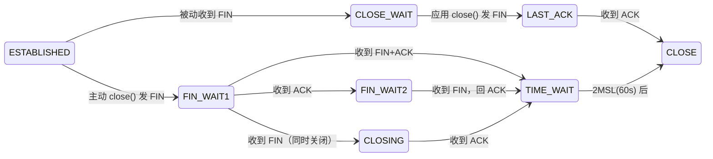

# 15. TCP 连接关闭与定时器体系

> 网络子系统 TCP 收尾篇。补齐「建立连接→传输数据」之后的另一半：四次挥手、TIME_WAIT、以及贯穿全程的定时器。

## 概念：四次挥手状态机



**核心记忆**：只有**主动关闭方**会进 `TIME_WAIT`；被动方收到自己的 FIN 的 ACK 后直接 `CLOSE` 消失。

## 原理：主动关闭源码链路

`close()` 系统调用 → `inet_release()` → `tcp_close()`（`net/ipv4/tcp.c:2936`）→ `__tcp_close()`（`tcp.c:2768`）。

### 1. 状态转换查表（`tcp.c:2678`）

```c
static const unsigned char new_state[16] = {
  [TCP_ESTABLISHED] = TCP_FIN_WAIT1 | TCP_ACTION_FIN,   // 发 FIN
  [TCP_SYN_RECV]    = TCP_FIN_WAIT1 | TCP_ACTION_FIN,
  [TCP_CLOSE_WAIT]  = TCP_LAST_ACK  | TCP_ACTION_FIN,   // 发 FIN
  [TCP_FIN_WAIT1]   = TCP_FIN_WAIT1,   // 已发过 FIN，不再发
  [TCP_CLOSING]     = TCP_CLOSING,
  ...
};

static int tcp_close_state(struct sock *sk)
{
	int next = (int)new_state[sk->sk_state];
	tcp_set_state(sk, next & TCP_STATE_MASK);
	return next & TCP_ACTION_FIN;   // 返回"要不要发 FIN"
}
```

这张表是主动关闭侧的**状态机路由表**：当前状态 → 下一状态 + 是否要发 FIN。

### 2. 发 FIN（`tcp_output.c:3507`）

```c
void tcp_send_fin(struct sock *sk)
{
	tskb = tcp_write_queue_tail(sk);
	if (tskb) {
		/* 优化：写队列还有未发出的 skb，FIN 标志 tack 上去，省一个包 */
		TCP_SKB_CB(tskb)->tcp_flags |= TCPHDR_FIN;
		TCP_SKB_CB(tskb)->end_seq++;      // FIN 占一个序号！
		tp->write_seq++;
	} else {
		tcp_init_nondata_skb(skb, tp->write_seq, TCPHDR_ACK | TCPHDR_FIN);
		tcp_queue_skb(sk, skb);
	}
	__tcp_push_pending_frames(sk, tcp_current_mss(sk), TCP_NAGLE_OFF);
}
```

**关键**：FIN 不是简单标志位，它**吃掉一个序列号**（`end_seq++`、`write_seq++`），所以 FIN 也要进重传队列、也要被 ACK——这是挥手也有超时重传的根本原因。

### 3. `__tcp_close` 的分支（`tcp.c:2768`）

```c
	if (tcp_sk(sk)->repair) {
		sk->sk_prot->disconnect(sk, 0);          // repair 模式直接断
	} else if (data_was_unread) {
		tcp_send_active_reset(sk, ...);          // 还有未读数据 → 发 RST 而非 FIN
	} else if (sock_flag(sk, SOCK_LINGER) && !sk->sk_lingertime) {
		sk->sk_prot->disconnect(sk, 0);          // SO_LINGER=0 → 直接 RST
	} else if (tcp_close_state(sk)) {
		tcp_send_fin(sk);                        // 正常优雅关闭 → FIN
	}
```

### 4. FIN_WAIT2 兜底（`tcp.c:2908`）

对方迟迟不发 FIN 时，`FIN_WAIT2` 会卡住，内核用 `linger2` 兜底：

```c
	if (sk->sk_state == TCP_FIN_WAIT2) {
		if (tp->linger2 < 0)                     // linger2 关闭 → 直接 RST
			tcp_send_active_reset(sk, ...);
		else {
			int tmo = tcp_fin_time(sk);          // 默认 60s
			if (tmo > TCP_TIMEWAIT_LEN)
				inet_csk_reset_keepalive_timer(sk, tmo - TCP_TIMEWAIT_LEN);
			else
				tcp_time_wait(sk, TCP_FIN_WAIT2, tmo);
		}
	}
```

## 原理：被动关闭 `tcp_fin`（`tcp_input.c`）

收到 FIN 报文 → `tcp_data_queue` → 检测 `TCPHDR_FIN` → `tcp_fin()`：

```c
	switch (sk->sk_state) {
	case TCP_ESTABLISHED:
		tcp_set_state(sk, TCP_CLOSE_WAIT);   // 半关闭：对方不发了，我方还能发
		inet_csk_enter_pingpong_mode(sk);
		break;
	case TCP_FIN_WAIT1:                        // 同时关闭
		tcp_send_ack(sk);
		tcp_set_state(sk, TCP_CLOSING);
		break;
	case TCP_FIN_WAIT2:                        // 回 ACK 进 TIME_WAIT
		tcp_send_ack(sk);
		tcp_time_wait(sk, TCP_TIME_WAIT, 0);
		break;
	}
```

**CLOSE_WAIT 的意义**：FIN 只表示对方"发送方向"关闭，对方仍能收数据。所以被动方进 CLOSE_WAIT 后还能 `send()`，等应用 `close()` 才发自己的 FIN 进 LAST_ACK。

## TIME_WAIT：为什么 2MSL + 源码

**为什么存在（两个原因）**：
1. **兜底最后的 ACK**：被动方回给 FIN 的 ACK 可能丢，主动方要在 TIME_WAIT 里重发。
2. **让旧连接的迟到报文消亡**，避免污染相同四元组的新连接。

源码 `tcp_minisocks.c:280`：

```c
void tcp_time_wait(struct sock *sk, int state, int timeo)
{
	/* 分配"缩水版 socket"：timewait_sock，只保留重发 ACK 需要的最小状态 */
	tw = inet_twsk_alloc(sk, &net->ipv4.tcp_death_row, state);
	if (tw) {
		/* 拷贝 rcv_nxt/snd_nxt/窗口/timestamp 等最少信息 */
		...
		if (state == TCP_TIME_WAIT)
			timeo = TCP_TIMEWAIT_LEN;    // 60s
		inet_twsk_schedule(tw, timeo);   // 启动定时器，到期销毁
		inet_twsk_hashdance(tw, sk, ...); // 挪进 TIME_WAIT 哈希桶
	}
	tcp_done(sk);   // 原 socket 销毁
}
```

**设计**：TIME_WAIT 不保留整个 `sock`，而是切成 `tcp_timewait_sock`（`tw`）——只有几十字节，只够收到迟到报文时回个 ACK。这就是内核能扛海量 TIME_WAIT 连接的原因。

## 定时器体系（`tcp_timer.c`，TCP 的心跳）

`include/net/inet_connection_sock.h:142` 定义 5 种写定时器：

| 宏 | 值 | 干什么 | handler |
|----|----|--------|---------|
| `ICSK_TIME_RETRANS` | 1 | RTO 超时重传 | `tcp_retransmit_timer` |
| `ICSK_TIME_DACK` | 2 | 延迟 ACK | `tcp_delack_timer_handler` |
| `ICSK_TIME_PROBE0` | 3 | 零窗口探测 | `tcp_probe_timer` |
| `ICSK_TIME_LOSS_PROBE` | 5 | 尾丢包探测 TLP | `tcp_write_timer_handler` |
| `ICSK_TIME_REO_TIMEOUT` | 6 | RACK 重排序超时 | `tcp_write_timer_handler` |

统一入口 `tcp_write_timer_handler`（`tcp_timer.c:653`）按 `icsk->icsk_pending` 分发：

```c
	switch (icsk->icsk_pending) {
	case ICSK_TIME_REO_TIMEOUT: tcp_rack_reo_timeout(sk); break;
	case ICSK_TIME_LOSS_PROBE:  tcp_send_loss_probe(sk);  break;
	case ICSK_TIME_RETRANS:     tcp_retransmit_timer(sk); break;  // RTO
	case ICSK_TIME_PROBE0:      tcp_probe_timer(sk);      break;  // 零窗口
	}
```

**一个 socket 同一时刻只有一个活跃的写定时器**（`icsk_pending` 记录是哪种），因为超时事件互斥。另有两个独立定时器：keepalive（`tcp_keepalive_timer`）和 TIME_WAIT 的 `tw_timer`。

至此「TCP 为什么可靠」闭环完整：**重传靠 RTO 定时器，挥手靠 FIN 序号 + ACK + TIME_WAIT 兜底**。

## 实验验证

BusyBox 有 `nc`、无 `tcpdump`，用 `/proc/net/tcp` 的 `st` 字段观测状态机。

状态码：`01=ESTABLISHED 04=FIN_WAIT1 05=FIN_WAIT2 06=TIME_WAIT 08=CLOSE_WAIT 09=LAST_ACK 0A=LISTEN`

```sh
# QEMU 内（12345 端口十六进制 = 3039）
nc -l -p 12345 &                          # 后台监听
nc 127.0.0.1 12345 < /dev/null &          # 连接后立刻关闭
sleep 0.2; cat /proc/net/tcp | grep 3039  # 观察 st=06（TIME_WAIT，持续 60s）
sleep 60;  cat /proc/net/tcp | grep 3039  # 60 秒后连接消失

# 高频采样抓中间状态
for i in $(seq 1 100); do cat /proc/net/tcp | grep 3039; sleep 0.01; done
```

## 陷阱

1. **`close()` 不一定发 FIN**：有未读数据、`SO_LINGER=0`、repair 模式都会发 RST 或不发。抓包看到 RST 时先查这三条。
2. **只有主动关闭方进 TIME_WAIT**，被动方直接 CLOSE。所以 TIME_WAIT 堆积总是出现在"先关连接"的那一端（通常是服务器）。
3. **FIN 占一个序列号**，所以挥手报文也有重传；TIME_WAIT 里的 ACK 重发正是靠这个序号。
4. 回环（loopback）上挥手极快，`FIN_WAIT1/2` 可能采样不到，但 `TIME_WAIT`（60s）一定可见。
