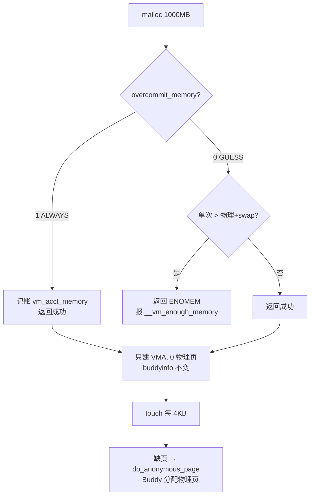

# 内存超卖 Overcommit：malloc 为什么会被拒绝

> 内存管理子系列第 5 篇。上一篇（04 缺页）讲清"malloc 不分配物理页"，但留下一个疑问：既然不分配物理页，为什么 `mem_hog 1000 0`（malloc 1GB 但不 touch）在 512MB 内存的机器上**直接返回 ENOMEM**？本篇回答：**malloc 不查物理内存，但要过一道"虚拟内存承诺"的账目检查。**

## 一、现象：同一程序，两种结果

在 512MB 物理内存、无 swap 的最小系统上：

```sh
# 默认策略（overcommit_memory=0）
# mem_hog 1000 0 &
# malloc: Cannot allocate memory
[  178.327672] __vm_enough_memory: pid: 127, comm: mem_hog, bytes: 1048580096 not enough memory for the allocation
[  178.327748] __vm_enough_memory: pid: 127, comm: mem_hog, bytes: 1048576000 not enough memory for the allocation
[  178.327793] __vm_enough_memory: pid: 127, comm: mem_hog, bytes: 1049624576 not enough memory for the allocation

# 改成"总是允许"（overcommit_memory=1）
# echo 1 > /proc/sys/vm/overcommit_memory
# mem_hog 1000 0 &
# pid=125 malloc=1000MB vaddr=0xffff4237d010 touch=0     ← 成功！
# cat /proc/buddyinfo
# Node 0, zone      DMA  ... 4    101                      ← order10 仍是 101，物理页一个没少
```

**核心结论：malloc 的成功与否由 `overcommit_memory` 策略决定（虚拟记账），物理内存占用由 touch 决定（缺页分配）。两者是两套独立机制。**

## 二、概念：overcommit 是什么

Linux 默认允许"超卖"（overcommit）：进程承诺的虚拟内存总和可以大于物理内存 + swap。理由是：

1. 进程常常申请了却不用（`malloc` 后不 touch，或只在峰值用）；
2. fork 的父子进程共享大量页（COW 只写时才算数）；
3. 如果按物理内存严格限制，会浪费大量内存，甚至 fork 大进程都失败。

但"随便超"也不行——如果允许一次性申请一个明显不可能兑现的量（1GB > 512MB 物理），那是在骗用户。所以内核在 malloc 时做一道**记账检查**。

## 三、源码：__vm_enough_memory

报错函数在 `mm/util.c:1032`，不是 `mm/mmap.c`：

```c
int __vm_enough_memory(struct mm_struct *mm, long pages, int cap_sys_admin)
{
	long allowed;
	unsigned long bytes_failed;

	vm_acct_memory(pages);                          // 先记账（无论策略）

	/* 模式 1：总是允许 */
	if (sysctl_overcommit_memory == OVERCOMMIT_ALWAYS)
		return 0;                                  // 直接放行，不检查

	/* 模式 0：启发式（默认） */
	if (sysctl_overcommit_memory == OVERCOMMIT_GUESS) {
		if (pages > totalram_pages() + total_swap_pages)
			goto error;                            // ★ 单次 > 物理+swap → 拒绝
		return 0;
	}

	/* 模式 2：严格记账 */
	allowed = vm_commit_limit();
	if (!cap_sys_admin)
		allowed -= sysctl_admin_reserve_kbytes >> (PAGE_SHIFT - 10);
	if (mm) {
		long reserve = sysctl_user_reserve_kbytes >> (PAGE_SHIFT - 10);
		allowed -= min_t(long, mm->total_vm / 32, reserve);
	}
	if (percpu_counter_read_positive(&vm_committed_as) < allowed)
		return 0;
error:
	bytes_failed = pages << PAGE_SHIFT;
	pr_warn_ratelimited("%s: pid: %d, comm: %s, bytes: %lu not enough memory for the allocation\n",
			    __func__, current->pid, current->comm, bytes_failed);
	vm_unacct_memory(pages);
	return -ENOMEM;
}
```

关键：这个函数检查的是**虚拟内存的"承诺额度"**，不是物理内存可用量。`vm_acct_memory` 是全局计数器 `vm_committed_as` 的增减（模式 2 才用到它）。

## 四、三种策略

`/proc/sys/vm/overcommit_memory`：

| 值 | 策略 | 行为 |
|----|------|------|
| **0** | `OVERCOMMIT_GUESS` 启发式（默认）| 允许合理超卖，但**拒绝单次分配 > 物理内存 + swap** 的离谱请求 |
| 1 | `OVERCOMMIT_ALWAYS` | 几乎不检查，随便 malloc |
| 2 | `OVERCOMMIT_NEVER` | 严格记账，总承诺不超过 `CommitLimit` |

```sh
cat /proc/sys/vm/overcommit_memory   # 默认 0
cat /proc/meminfo | grep -E 'Commit' # 模式 2 相关：CommitLimit / Committed_AS
```

## 五、为什么 1GB 被拒（启发式）

```
物理内存  totalram_pages   = 512 MB
swap      total_swap_pages = 0（最小系统没配 swap）
malloc 1GB = 1000 MB
1000 MB > 512 MB + 0   → 启发式判定"明显不可能" → 返回 ENOMEM
```

启发式**只检查单次分配**，不累计。所以：

```sh
mem_hog 10 0 &   # 10MB < 512MB ✓ 成功
mem_hog 10 0 &   # 再 10MB ✓ 成功
# ... 重复 100 次，累计 1GB 虚拟内存，全部成功！
```

只有模式 2 才会用 `vm_committed_as` 累计算总账。

## 六、三行报错的字节数 → 暴露 glibc 的 mmap 路径

```
bytes: 1048580096 = 1000MiB + 4096   (1000×1024×1024 + 4KB)
bytes: 1048576000 = 1000MiB 整       (1000×1024×1024)
bytes: 1049624576 = 1000MiB + 1MiB   (1001×1024×1024)
```

不是内核重试 3 次，而是 **glibc 对超大 malloc 直接走 `mmap()` 路径**：1GB > `MMAP_THRESHOLD`（默认 128KB），glibc 尝试了 3 种对齐/元数据大小的组合。**每一次 mmap 都独立调用一次 `__vm_enough_memory`**，每次 1000MiB 都 > 512MB，所以三次全拒，打印 3 条。

## 七、心智模型（malloc 两阶段）



## 八、实验记录

| 操作 | overcommit_memory | 结果 | 物理内存（order10） |
|------|-------------------|------|------|
| `mem_hog 1000 0` | 0（默认）| ENOMEM，3 条报错 | 不变 |
| `mem_hog 1000 0` | 1（ALWAYS）| 成功 | 101 → 101（不变）|
| `mem_hog 200 1`（touch）| 任意 | 成功 | 103 → 54（真分配 196MB）|

## 九、陷阱

1. **"malloc 随便超"是错的**：默认启发式会拒绝单次超过物理+swap 的分配。
2. **检查的是承诺不是物理**：`__vm_enough_memory` 里 `pages > totalram+swap` 是对比"本次申请"和"总容量"，不是对比"已用物理内存"。
3. **三行报错不是三条线程**：是 glibc 一次 malloc 的 3 次 mmap 尝试。
4. **touch=0 时 buddyinfo 不变**：这是验证"malloc 不分配物理页"最直接的手段。

## 十、衔接模块 5（内存回收）

overcommit 允许"承诺超卖"，但 touch 时物理内存是有限的。当空闲内存跌破水位线，就要**回收**：kswapd 醒来 → 回收页缓存 / 换出匿名页 → 还不行就 OOM Killer 杀进程。这正是下一篇的主题。

---

**验证过的命令**（QEMU 内）：

```sh
cat /proc/sys/vm/overcommit_memory        # 0
echo 1 > /proc/sys/vm/overcommit_memory   # 改为总是允许
mem_hog 1000 0 &                          # 成功，buddyinfo 不变
echo 0 > /proc/sys/vm/overcommit_memory   # 改回默认
```
