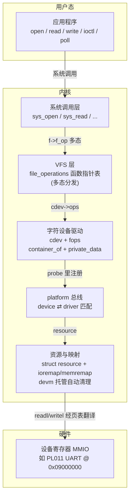
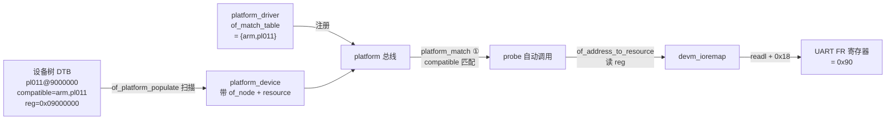
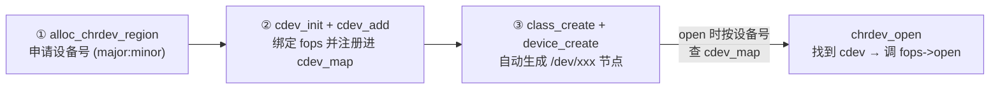
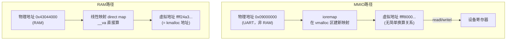
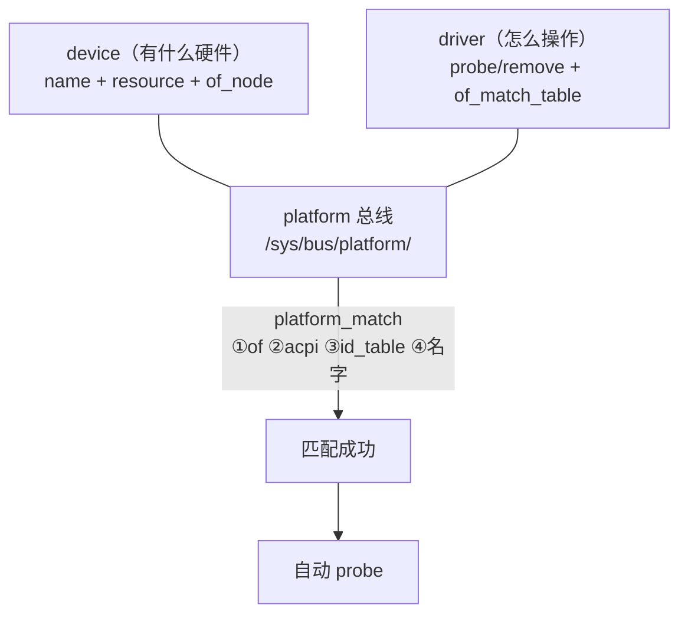

# 驱动知识全景图

> 06-module 总纲。用五张图串起「内核模块 → 字符设备驱动 → platform 总线 → 资源映射 → 设备树」的完整知识体系。建议学完 01~14 课后回看本图，检验是否能把每条链路讲清楚。

## 一、总览：从用户态到硬件的完整链路

## 二、设备树驱动的匹配流程

## 三、字符设备注册三步

## 四、地址映射的两条路

## 五、设备-驱动-总线三要素

## 学习路径索引（01~14）

| 课 | 主题 | 关键点 |
|---|---|---|
| 01 | hello 模块与 taint | 模块结构、编译三前提、taint 标记 |
| 02 | insmod 调用链 | finit_module/init_module、load_module 十五步 |
| 03 | 模块重定位 | 定址、定符号、改写引用 |
| 04 | EXPORT_SYMBOL | __ksymtab、find_symbol、模块依赖 |
| 05 | module_param | 宏展开、__param 段、param_ops |
| 06 | 字符设备驱动 | cdev、file_operations、设备号、chrdev_open |
| 07 | 字符设备驱动进阶 | write/ioctl、class_create/device_create |
| 08 | 多实例设备驱动 | container_of、file->private_data |
| 09 | 阻塞 IO | wait_event_interruptible、wake_up |
| 10 | poll/epoll | .poll 回调、poll_wait、EPOLLIN |
| 11 | platform 驱动 | 总线-设备-驱动、platform_match、probe 自动回调 |
| 12 | 设备资源与 ioremap | ioremap 拒绝 RAM、memremap、线性映射、别名映射 |
| 13 | 资源声明与 devm 托管 | request_mem_region、BUSY 标志、devm 自动清理 |
| 14 | 设备树驱动 | of_ 接口、of_match_table、模式 A vs B、alloc/add 坑 |
