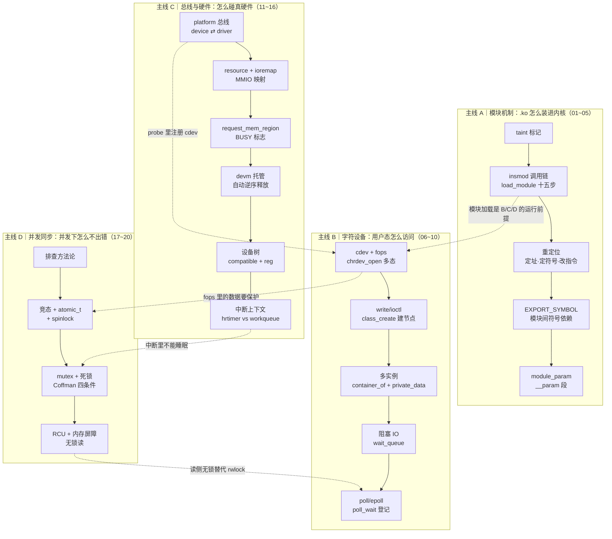

# 驱动开发阶段回顾与自检

> 06-module 收尾课。把 01~20 共 20 篇文档重新组织成「四条主线」，给出一份可打勾的能力自检清单、一张原理速查表、一份实测数字总表，以及一份「还缺什么」的诚实清单。

前置阅读：[00-驱动知识全景图](./00-驱动知识全景图.md)（五张链路图）。
本篇不重复全景图的图，而是**换一个维度**：不再按「数据流」画，而是按「知识依赖」串。

---

## 一、四条主线与依赖关系

20 课看起来零散，其实是四条互相咬合的主线：



**读法**：
- 主线 A 是**地基**——不懂 insmod 就不知道 `module_init` 什么时候被调；
- 主线 B、C 是**两条正交的访问路径**（B 解决「用户态怎么调到我」，C 解决「我怎么报到总线、怎么碰寄存器」），真实驱动是 **B+C 叠在一起**（platform probe 里注册 cdev）；
- 主线 D 是**横切关注点**——B、C 的每个回调都要问「这段代码会被几个 CPU 同时进」。

真实驱动长这样（B+C+D 合体）：

```
platform_driver.probe()          ← 主线 C：总线匹配上我
├── devm_ioremap_resource()      ← 主线 C：拿寄存器
├── devm_request_irq()           ← 主线 C：报中断
├── alloc_chrdev_region()        ← 主线 B：申请设备号
├── cdev_init + cdev_add         ← 主线 B：绑定 fops
└── spin_lock_init(&priv->lock)  ← 主线 D：准备保护共享数据
```

---

## 二、能力自检清单（40 题）

> 用法：逐题自问，**能不看文档讲清「是什么 + 为什么必须这样 + 源码在哪」才算过**。讲不清的回去看对应文档。

### 主线 A｜模块机制（01~05）

| # | 自检问题 | 参考答案要点 | 课 |
|---|---|---|---|
| 1 | `insmod` 和 `modprobe` 最本质的区别？ | insmod 直给路径不走依赖；modprobe 查 `/lib/modules/.../modules.dep` 递归先加载依赖 | 01 |
| 2 | 内核被 taint 意味着什么？`lsmod` 里 `(O)` 是什么？ | 出问题厂商可拒绝支持；`O` = out-of-tree 非树内模块 | 01 |
| 3 | `.ko` 编译为什么必须要 `Module.symvers`？ | 里面是内核导出符号的 CRC 校验值，缺了就只能编出「未知符号版本」的模块，加载时可能拒 | 01 |
| 4 | `finit_module` 和 `init_module` 都干什么？现在用哪个？ | 前者传 fd（内核自己读，你不用把整个 .ko 拷进用户态 buffer），后者传 buffer；modprobe/insmod 走 finit_module | 02 |
| 5 | 同名模块二次 insmod 会怎样？在哪一层被拦？ | 内核里按模块名幂等去重，返回 `-EEXIST`，不是重复加载 | 02 |
| 6 | 为什么 `.ko` 里的函数地址在磁盘上是 0 或占位？ | 编成位置无关、未定址的形式，加载时才确定基址 | 03 |
| 7 | 「定址 / 定符号 / 改指令」三步各做什么？ | layout_and_allocate 分配模块内存并定基址；simplify_symbols 把符号表项解析成真实地址；apply_relocations 按平台规则改写指令里的立即数/偏移 | 03 |
| 8 | arm64 上的重定位为什么要改指令而不只是填个地址？ | `bl` 的相对偏移存在指令编码里（26 位），必须原地重算 | 03 |
| 9 | `EXPORT_SYMBOL` 和 `EXPORT_SYMBOL_GPL` 区别？ | GPL 版只对 GPL 兼容模块可见，非 GPL 模块找不到符号 | 04 |
| 10 | `lsmod` 的 `Used by` 列从哪来？模块卸载时怎么判断能不能卸？ | 来自模块的 `refcnt`（依赖它的模块数 + 显式 get）；refcnt≠0 拒绝 `-EBUSY` | 04 |
| 11 | `module_param(x, int, 0644)` 展开成什么？参数什么时候解析？ | `module_param_named` → 一个 `struct kernel_param` 放进 `__param` 段；`do_init_module` 里在调你的 `init` **之前**解析 | 05 |
| 12 | 0644 这个权限位是给谁的？ | sysfs 里 `/sys/module/<name>/parameters/x` 的权限 | 05 |

### 主线 B｜字符设备（06~10）

| # | 自检问题 | 参考答案要点 | 课 |
|---|---|---|---|
| 13 | 从 `open("/dev/xxx")` 到你的 `fops->open` 之间的完整链路？ | openat → do_sys_open → 路径解析拿到 inode → `chrdev_open` 按 `i_rdev` 查 `cdev_map` → `cdev->ops->open` | 06 |
| 14 | `file_operations` 在内核里扮演什么角色？ | VFS 的虚函数表，C 语言版多态；`f_op` 不同 → 同一份 VFS 代码跑出不同行为 | 06 |
| 15 | 主设备号、次设备号各表示什么？ | 主 = 哪一类驱动 / 哪个 cdev；次 = 该类里的第几个实例 | 06 |
| 16 | `read()` 返回 0 意味着什么？为什么用户态 `cat` 会退出？ | EOF；`cat` 见 0 就认为读完了 | 06 |
| 17 | `copy_to_user` 失败为什么常返回「读到的字节数」而不是 -EFAULT？ | 部分拷贝语义：告诉用户态已经成功多少，符合 read 的返回约定 | 06 |
| 18 | `unlocked_ioctl` 的 `cmd` 为什么通常用魔数？ | 防止别的设备驱动误认自己的 ioctl；内核有 `_IO/_IOR/_IOW` 宏编解码方向+大小 | 07 |
| 19 | 不写 `class_create/device_create` 会怎样？ | 没有自动 `/dev` 节点，得手动 `mknod` | 07 |
| 20 | 多实例驱动怎么从回调里认出「我是谁」？ | `container_of(inode->i_cdev, struct my_dev, cdev)` 反推，存 `file->private_data` | 08 |
| 21 | 为什么 `private_data` 要在 `open` 里存、`release` 里清？ | 它是 per-open-file 的；同一个设备两次 open 是两个独立上下文 | 08 |
| 22 | `wait_event_interruptible` 内部做了什么？为什么必须配一个「条件」？ | 加 wait_queue 项 → 设 TASK_INTERRUPTIBLE → schedule；条件检查在循环里防虚假唤醒 | 09 |
| 23 | `interruptible` 版本被信号打断返回什么？调用方怎么处理？ | `-ERESTARTSYS`，应返回给用户态让它重试 | 09 |
| 24 | `poll` 里 `poll_wait` 的作用？为什么不能只返回 mask？ | 把当前 wait_queue 登记到 epoll 的监听表，数据到了才能主动唤醒；只返回 mask 是「一次性问」 | 10 |
| 25 | epoll 一个线程等 N 个设备，靠内核什么机制？ | 每个设备 `poll_wait` 登记同一个 wait_queue（或各自），`ep_poll_callback` 唤醒 | 10 |

### 主线 C｜总线与硬件（11~16）

| # | 自检问题 | 参考答案要点 | 课 |
|---|---|---|---|
| 26 | platform 总线为什么要拆成 device 和 driver？ | 「有什么硬件」和「怎么驱动」可独立演进：同一驱动匹配多块板，同一板子换驱动 | 11 |
| 27 | `platform_match` 的匹配顺序？ | ① of（compatible）② acpi ③ id_table ④ 名字字符串 | 11 / 14 |
| 28 | `platform_driver_register` 之后 probe 什么时候被调？ | 注册时扫一遍总线上的 device；之后有 device 加入时再匹配 | 11 |
| 29 | `ioremap` 对 RAM 物理地址为什么会失败？ | arm64 `__ioremap_prot` 用 `pfn_is_map_memory()` 拒绝 RAM，防止产生缓存属性冲突的别名映射 | 12 |
| 30 | 那 RAM 地址要用什么？为什么 `memremap` 返回的地址可能和 `kmalloc` 一样？ | `memremap(..., MEMREMAP_WB)`；`try_ram_remap` 对 RAM 直接返回 `__va(offset)`，复用线性映射 | 12 |
| 31 | `virt_to_phys` 能用在 vmalloc/ioremap 地址上吗？ | 不能，只对线性映射有效；ioremap 出来的要走页表反查 | 12 |
| 32 | `request_mem_region` 和 `insert_resource` 的关键区别？ | 前者会设 `IORESOURCE_BUSY`，后者不设 → 不设 BUSY 时别人还能在你上面嵌套申请 | 13 |
| 33 | devm 的释放顺序为什么能保证正确？ | devres 是链表，卸载时**逆序**弹出，后申请的先释放，天然符合资源依赖 | 13 |
| 34 | `devm_platform_ioremap_resource(pdev, 0)` 干了三件事？ | `platform_get_resource` + `devm_request_mem_region` + `devm_ioremap` | 13 |
| 35 | `of_find_node_by_name(NULL, "pl011@9000000")` 为什么找不到？ | 设备树 node 的 `name` 是 `pl011`，`full_name` 才带 `@单位地址`；要按名字找得用不带 @ 的 | 14 |
| 36 | DTB 的 `reg` 属性怎么变成 `struct resource`？ | `of_address_to_resource` 解析 `reg = <addr size>` 填进 `IORESOURCE_MEM` | 14 |
| 37 | 只 `platform_device_alloc` 不 `platform_device_add`，probe 会调吗？ | 不会；alloc 只是造了个壳，add 才挂到总线上。对称性：alloc↔add、register↔unregister | 14 |
| 38 | `timer_list` 和 `hrtimer` 的精度差多少？为什么？ | 实测 1024ms vs 1000.025ms，1000 倍；`timer_list` 走时间轮，HZ=250 时 LVL1 粒度 8 tick = 32ms | 15 |
| 39 | 在 hrtimer 回调（softirq 上下文）里为什么不能 `msleep`？ | 会睡眠，但软中断上下文不允许调度 | 16 |
| 40 | 怎么在代码里判断自己当前在什么上下文？ | `in_task()` / `in_serving_softirq()` / `in_interrupt()`；**不要用 `in_atomic()`** —— PREEMPT_RT 下它只看 `preempt_count`，softirq 计数在 `current->softirq_disable_cnt` 里，会误判为 0 | 16 / 17 |

### 主线 D｜并发同步（17~20）

| # | 自检问题 | 参考答案要点 | 课 |
|---|---|---|---|
| 41 | `poll`/`dmesg` 里看到异常，你的五步排查法是？ | ① 描述现象 ② 列信息源 ③ 判断链 ④ 坑 ⑤ 提炼通用方法论 | 17 |
| 42 | `i++` 为什么在多核上会丢更新？ | 编译成 load-modify-store 三条指令，指令间隙可被抢占/并行 | 18 |
| 43 | `atomic_inc` 为什么不会丢？ | 用 arm64 的 `ldaxr` / `stlxr` 独占访问对，硬件保证原子 | 18 |
| 44 | spinlock 临界区里为什么不能睡眠？ | 持有锁时自旋的其他 CPU 会被卡死；且睡眠可能换出，导致持锁进程不在 CPU 上 | 18 |
| 45 | spinlock 和 mutex 怎么选？ | 能睡（进程上下文 + 临界区可能长/要调阻塞函数）→ mutex；不能睡（中断/软中断上下文 + 临界区极短）→ spinlock | 19 |
| 46 | ABBA 死锁的四个必要条件？ | 互斥、持有并等待、不可剥夺、循环等待；破坏任一即可 | 19 |
| 47 | lockdep 能查出 ABBA 死锁吗？为什么本环境查不出？ | 能（静态建锁依赖图查环）；但 `CONFIG_PROVE_LOCKING is not set` | 19 |
| 48 | 不能开 lockdep 时怎么安全探测死锁？ | `mutex_trylock` 拿不到就返回错误，不阻塞，从而绕开「死等」 | 19 |
| 49 | RCU 读侧为什么是「零开销」？ | 没有锁、没有原子操作、不需要释放，编译器可当普通读写优化 | 20 |
| 50 | RCU 写者的四步？ | 复制 → 改副本 → `rcu_assign_pointer` 发布 → `synchronize_rcu` 等宽限期 → `kfree` 旧版 | 20 |
| 51 | 宽限期为什么不能省？直接 kfree 会怎样？ | 有读者可能正拿着旧指针读；提前释放 = use-after-free | 20 |
| 52 | 为什么必须用 `rcu_assign_pointer` / `rcu_dereference`，不能直接赋值？ | 内含 release / acquire 屏障，防止编译器/CPU 把「写数据」和「发布指针」重排 | 20 |
| 53 | 实时系统里 `synchronize_rcu` 的代价？替代方案？ | 实测 17~25ms，会阻塞写者；改用 `call_rcu` 异步回调释放 | 20 |

---

## 三、原理速查表：每个机制「为什么必须存在」

一份压缩版，用于面试前 5 分钟速刷。

| 机制 | 一句话存在理由 | 代价 |
|---|---|---|
| taint | 让厂商能一眼区分「原生内核问题」和「第三方模块引起的问题」 | 无 |
| Module.symvers | 保证模块和内核的符号 ABI 一致，防「版本错配」的诡异崩溃 | 换内核必须重编模块 |
| 重定位 | `.ko` 无法预知自己会被放在哪个地址，必须加载时现算 | 加载慢一点点 |
| EXPORT_SYMBOL | 模块之间要能互相调用函数，但符号默认是模块私有的 | refcnt 管理不好会泄漏 |
| cdev + fops | 一个 `chrdev_open` 服务所有字符设备，靠 f_op 多态分发 | 间接调用，无法内联 |
| container_of | C 没有继承，用「成员地址 - 偏移」反推宿主结构体，实现 C 版向下转型 | 零成本（编译期算偏移） |
| wait_queue | 没有它就只能轮询，CPU 白烧 | 唤醒有延迟 |
| poll_wait | 让内核在数据到达时**主动**通知，而不是用户态反复问 | 需要驱动正确实现 |
| platform 总线 | 把「硬件描述」和「驱动代码」解耦，一套代码多块板子复用 | 多一层间接 |
| resource | 让内核知道谁占了哪段物理地址，避免两个驱动抢同一段 | 必须成对 request/release |
| ioremap | 设备寄存器物理地址不在线性映射区，且需要 `Device` 内存属性（不可缓存） | 占用 vmalloc 空间 + TLB |
| devm | 忘了释放是驱动最常见 bug；把释放动作交给设备生命周期自动管 | 想提前释放要 `devm_*free` |
| 设备树 | 板级差异从「改 C 代码重编」变成「改 DTB 不用重编内核」 | DTB 写错很难查 |
| timer_list | 低精度、便宜、适合超时/延时 | 精度受 HZ 限制（实测 1024ms） |
| hrtimer | 需要 ms 以下精度（实时、音视频、传感器采样） | 红黑树操作，比时间轮贵 |
| workqueue | 中断/软中断里不能睡眠，把耗时工作推到进程上下文 | 有调度延迟 |
| atomic_t | 计数器类场景不想要锁的开销 | 只能做单变量原子操作 |
| spinlock | 中断上下文里唯一能用的互斥手段 | 忙等烧 CPU |
| mutex | 长临界区/要睡眠时不能用 spinlock | 有调度开销，中断里不能用 |
| lockdep | ABBA 死锁靠跑测试撞不出来，需要在锁**获取顺序**上做静态检查 | 内核变慢很多，量产不开 |
| RCU | 读多写少场景，让读者完全免锁，读性能接近无锁 | 写者要等宽限期（实测 17~25ms）+ 内存占用延迟 |

---

## 四、实测数字总表

所有数字都来自本环境的真实运行（QEMU virt / 4 CPU / 内核 6.12.112 PREEMPT_RT / HZ=250）。

| 实验 | 关键数字 | 说明 |
|---|---|---|
| `hello_timer` | **1024 ms**（= 256 jiffies） | HZ=250，timer wheel LVL1 粒度 8 tick，系统性能差 24ms |
| `hello_hrtimer` | **999.985 ~ 1000.024 ms** | 偏差 ±25 μs，比 timer_list 精细约 1000 倍 |
| `hello_race` | plain = **3999603**（丢 **397**）<br/>atomic = **4000000**<br/>locked = **4000000** | 4 线程 × 100 万次；裸 `++` 丢 0.01% |
| `hello_deadlock` | `[B] trylock A FAILED -> would deadlock` | `mutex_trylock` 安全探测 ABBA |
| `hello_wq` | hrtimer 回调：`in_task=0 in_serving_softirq=256 in_atomic=0`<br/>workqueue：`in_task=1 in_serving_softirq=0` | **`in_atomic=0` 是 PREEMPT_RT 的坑** |
| `hello_rcu` | 宽限期 **25287 μs** / **17044 μs** | 17~25ms 波动，PREEMPT_RT + nohz_full + QEMU |
| `hello_iomem` | `UART FR = 0x90` | 读 PL011 @ 0x09000000 + 0x18 |
| `hello_dt` | `probe called, name=my-uart` + `FR=0x90` | compatible `arm,pl011` 匹配成功 |
| `hello_irq` | irq 25 → `-EBUSY`（`Flags mismatch 00202084 vs 00202004`） | rtc-pl031 不支持 `IRQF_SHARED` |
| `hello_irq_free` | irq 12 → `-EINVAL` + WARN | PPI（16~31）是 per-CPU 中断，不能 request |

> `hello_irq` / `hello_irq_free` 的失败**本身就是结论**：QEMU 里没有「空闲的、可共享的 SPI 中断」给你练手。真实中断驱动要等有真实外设（或 virtio 设备）才能实验。这属于环境限制，不是知识缺口。

---

## 五、踩坑清单（按类型归类，共 20 条）

这一节比自检清单更有价值——**同类坑在真实项目里会反复出现**。

### 生命周期不对称（最致命）

| 坑 | 后果 | 铁律 |
|---|---|---|
| `platform_device_alloc` 没配 `platform_device_add` | probe 不调用，看着「成功了但没反应」 | **alloc ↔ add 必须成对** |
| 对没 add 的 device 调 `platform_device_unregister` | `refcount_t: addition on 0` + 内核崩溃 | 没 add 就只能 `platform_device_put` |
| kthread 函数 `return 0` 后还调 `kthread_stop` | `rc=139` 段错误，task_struct 已释放 | **线程自己退出就不能再 stop**；要同步就用 `completion` |
| `register_chrdev_region` 没配 `unregister` | 设备号泄漏，重插模块 `-EBUSY` | 每个 register 都要有反操作 |

### 上下文误判

| 坑 | 后果 | 铁律 |
|---|---|---|
| softirq 里调 `msleep` | 内核告警 / 卡死 | 软中断、中断上下文禁止睡眠 |
| 用 `in_atomic()` 判断能否睡眠 | PREEMPT_RT 下返回 0，**误判为可睡眠** | 用 `in_task()` / `in_serving_softirq()` / `in_interrupt()` |
| 在 hrtimer 回调里做重活 | 软中断长时间不返回，延迟爆炸 | 重活丢给 workqueue |

### 地址与映射

| 坑 | 后果 | 铁律 |
|---|---|---|
| 对 `kmalloc` 出来的地址 `ioremap` | `WARNING at arch/arm64/mm/ioremap.c:27` | RAM 用 `memremap(MEMREMAP_WB)` 或直接 `__va` |
| 以为 `memremap` 一定返回新地址 | 返回值和 kmalloc 一样，误以为 bug | RAM 走 `try_ram_remap` → `__va`，复用线性映射 |
| 对 ioremap 地址用 `virt_to_phys` | 得到垃圾值 | 只有线性映射地址能用 |

### 资源与 BUSY 语义

| 坑 | 后果 | 铁律 |
|---|---|---|
| 只用 `insert_resource` 没用 `request_mem_region` | 别的驱动能嵌套申请同一段，冲突不报错 | 驱动要设 `IORESOURCE_BUSY` |
| 以为 `devm_ioremap_resource` 冲突一定 `-EBUSY` | 上游资源没设 BUSY 时会成功嵌套 | 看 `/proc/iomem` 有没有 `B` 标志 |

### 匹配与查找

| 坑 | 后果 | 铁律 |
|---|---|---|
| `of_find_node_by_name(NULL, "pl011@9000000")` | 返回 NULL；`name` 不含 `@地址` | 按路径用 `of_find_node_by_path("/pl011@9000000")` |
| `of_match_table` 忘写 `{}` 结尾哨兵 | 越界读，随机匹配失败 | 数组最后必须有空项 |
| 把 `res.start` 直接给数组 | 编译错误 | 遍历 `platform_get_resource` |

### 编译与工具链（BusyBox 特有）

| 坑 | 后果 | 铁律 |
|---|---|---|
| `dmesg -C` | BusyBox 不支持，报错 | 用 `dmesg -c` |
| `comm` 配 `sort -n` | 比的是字符串，结果错乱 | `comm` 必须配字典序 `sort`（不带 `-n`） |
| `<(cmd)` 进程替换 | BusyBox sh 不支持 | 用临时文件 |
| `nc -q` | busybox nc 无此选项 | 换 `telnet` 或 Python 脚本 |

---

## 六、还缺什么（诚实清单）

学完 20 课，你具备了「写一个能跑、能被访问、能碰硬件、并发正确」的驱动能力。但距离**量产驱动工程师**还有几块明确的空白：

| 缺口 | 为什么重要 | 建议补充方式 |
|---|---|---|
| **rwsem / seqlock / per-CPU 变量** | 同步原语全家桶还差这几个；`per-CPU` 是内核最常用的「免锁」手段 | 用到时补，原理与 RCU 同源 |
| **真实中断驱动** | 目前 `request_irq` 全失败，没跑通「中断 → 唤醒读者」的完整闭环 | 用 virtio 设备或 GPIO 子系统 |
| **DMA 驱动** | 高速外设（摄像头、网卡、CAN）必经之路；涉及 `dma_alloc_coherent`、cache 一致性 | 配合 `05-memory/16 DMABUF` 一起看 |
| **内核框架子系统** | 真实驱动很少直接写 cdev，多是挂进 IIO / input / net / tty 框架 | 写一个 IIO 或 input 驱动 |
| **regulator / clk / pinctrl** | 现代 SoC 驱动三件套，probe 里几乎必调 | 有真实板子时学 |
| **设备树 binding 规范** | 写 binding YAML + `make dt_binding_check` 才是正规军 | 结合 `Documentation/devicetree/bindings/` |
| **调试工具链（ftrace / perf / eBPF）** | 前面所有子系统都能用观测工具回头验证；eBPF 是现代驱动/内核调试的主力 | **规划中的下一阶段** |

---

## 七、下一步：转向汽车落地

按既定路线，06-module 到此收尾。接下来的方向：


**第一步：CAN 驱动**。理由：

1. **CAN 是汽车软件的绝对核心**——AUTOSAR、vsomeip、SOA 都跑在它上面；
2. 它能把 06-module 的知识**全部串起来**：
   - 模块机制 → 一个 CAN 驱动就是个 `.ko`
   - 字符设备 / 网络设备 → SocketCAN 把 CAN 抽象成网络接口（`net_device`），可以顺带补「网络设备驱动」这块空白
   - 中断上下文 → CAN 收发天然是中断驱动
   - workqueue → 中断上半部收帧，下半部推给协议栈
   - 并发同步 → CAN 报文队列的并发保护
   - 定时器 / hrtimer → CAN 周期报文、超时重传
3. QEMU 里有 **vcan（虚拟 CAN）** 可用，不需要真实硬件就能完成实验。

---

## 八、本阶段成果清单

| 类别 | 产出 |
|---|---|
| 文档 | `doc/06-module/` 共 **22 篇**（00~21） |
| 实验 | `experiments/module/` 下 **14 个** 可加载模块 |
| 能力 | 模块开发全流程 / 字符设备 / platform 总线 / 设备树 / 资源映射 / 定时器 / 中断上下文 / 并发同步（atomic·spinlock·mutex·RCU） |
| 方法论 | 五步排查法 + 20 条踩坑清单 |
